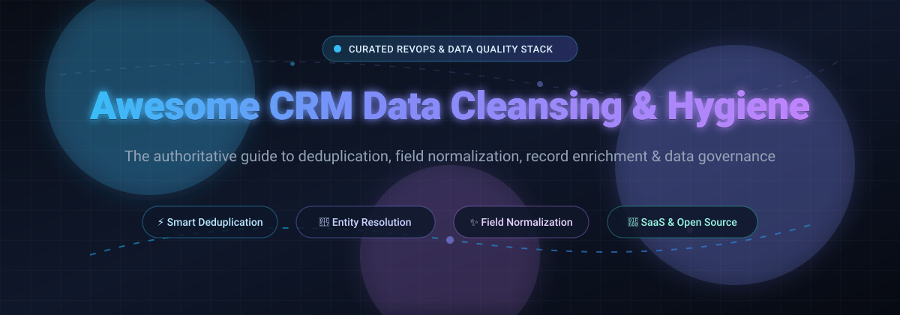

# ⚡ Awesome CRM Data Cleansing & Hygiene 🧹

**The ultimate curated directory of enterprise SaaS solutions and open-source GitHub projects for CRM deduplication, field normalization, record linkage, and data hygiene.**

  
  
  
  
  
  

*Master B2B CRM data quality across HubSpot, Salesforce, Dynamics, and data warehouses with transparent pricing, free tier limits, entity resolution engines, and self-hosted tools.*

🌟 **Star this repository if it helps your RevOps or Data Engineering workflow!** 🌟

---

## 📑 Table of Contents

- [🔍 Sector Overview & Market Dynamics](#-sector-overview--market-dynamics)
- [🏢 SaaS & Hosted Platforms](#-saashosted-platforms)
- [💻 Open-Source GitHub Projects](#-open-source-github-projects)
- [🛠️ Key Evaluation & Selection Framework](#️-key-evaluation--selection-framework)
- [📈 Star History](#-star-history)
- [🤝 How to Contribute](#-how-to-contribute)
- [💖 Support & Sponsorship](#-support--sponsorship)
- [⚠️ Disclaimer](#️-disclaimer)

---

## 🔍 Sector Overview & Market Dynamics

The global data quality and CRM data cleansing software market is valued at approximately **$2.9B–$3.9B** (growing at an estimated 11–17% CAGR toward $4B+). The market exhibits a **hybrid structure**—it is **concentrated at the foundational cloud platform layer** (where mega-vendors like Salesforce, Microsoft, and enterprise MDM providers control core CRM repositories), but **highly fragmented across the specialized cleansing and hygiene layer**, where dozens of point solutions, enrichment engines, and niche deduplication vendors compete without a single "winner-take-all" player dominating cross-platform data hygiene.

---

## 🏢 SaaS & Hosted Platforms

| Product | 🏢 Company Scale (Valuation / Revenue) | 🏷️ Starting Pricing Tier | 🎁 Free Tier & Free Trial Limits | 🎯 Key Focus & Platform Coverage |
| :--- | :--- | :--- | :--- | :--- |
| **[HubSpot (Data / Operations Hub)](https://www.hubspot.com/)** | **~$15B–$25B Market Cap** ($3.13B FY25 Revenue) | **$15/seat/month** (Starter, billed annually) / **$720/month** (Professional with bulk deduplication & automated data quality) | **Permanent free tier available**: Unlimited users, default contact/company deduplication at entry (email/domain match), manual deduplication merges; 14-day free trial on paid tiers | 📊 Native CRM data quality command center, bulk record merge, automated property formatting, and multi-system data sync |
| **[ZoomInfo Clean](https://www.zoominfo.com/)** | **~$1.3B–$3.1B Market Cap** ($1.25B FY25 Revenue) | **$14,995/year** (Professional base tier; Clean add-on typically adds $5,000–$20,000/year depending on record volume) | **Permanent free tier (ZoomInfo Lite)**: 10 export credits/month (up to 25/month with contact contribution); Sales-led trial provides 3–7 days with ~5 test credits | 🔍 B2B contact verification, enterprise CRM record enrichment, deduplication, and automated data standardization |
| **[DemandTools](https://www.demandtools.com/)** *(Validity)* | **~$100M+ Est. Valuation** (~$40M–$60M Est. Revenue) | **$1,200/year** (Elements tier base package for small business orgs) | **14-day free trial**: Sandbox testing & assessments permitted; live production record merging/export locked until paid license | ☁️ Bulk Salesforce deduplication, mass data modification, standardized lead routing, and database maintenance |
| **[RingLead](https://www.ringlead.com/)** *(ZoomInfo)* | **$118M Acquisition Valuation** (Acquired by ZoomInfo) | **$19,200/year** (OperationsOS base annual contract) | **No self-serve free tier**: 7-day sales-assisted pilot / POC trial upon sales engagement | 🛡️ Point-of-entry deduplication, lead-to-account matching, multi-vendor enrichment, and Salesforce/Marketo normalization |
| **[Openprise](https://www.openprisetech.com/)** | **~$100M Post-Money Valuation** ($15M–$19M Est. Revenue) | **$35,000/year** (Professional Plan, billed annually; unlimited users) | **No free tier & no self-serve trial**: Enterprise interactive demo & custom POC available upon qualification | ⚙️ Enterprise RevOps data orchestration, multi-system CRM/MAP harmonization, lead scoring, and automated field hygiene |
| **[Leadspace](https://www.leadspace.com/)** | **~$70M–$100M Est. Valuation** ($17M+ Est. Revenue; $102M+ raised) | **$49/month** (Solo Tier; Custom Enterprise tiers) | **Permanent free tier (Starter)**: 25 free credits/day via Sidekick extension for contact email/phone verification | 👥 B2B customer data platform (CDP), real-time profile resolution, and CRM record enrichment |
| **[Syncari](https://syncari.com/)** | **~$62M–$100M Valuation** ($7M Est. Revenue; $28M raised) | **$25,000 one-time** (3-month POC package, up to 10 connectors) | **30-day free trial**: Guided interactive "Test Drive" environment with preloaded sample CRM data sets and connectors | 🔄 Agentic Master Data Management (MDM), bi-directional CRM state sync, multi-system deduplication, and automated data governance |
| **[Cloudingo](https://www.cloudingo.com/)** | **~$10M Est. Valuation** ($3M–$7M Est. Revenue; Bootstrapped) | **$2,500/year** (Standard Tier for Salesforce orgs up to 300,000 records) | **10-day free trial**: Includes 25 merge tokens (deduplicate and merge up to 25 duplicate record groups across 1 production & 1 sandbox org) | ⚡ Salesforce-native deduplication, scheduled automated merge rules, mass update/delete, and ERP/API import hygiene |
| **[WinPure](https://www.winpure.com/)** | **~$5M Est. Valuation** ($1.2M Est. Revenue; Bootstrapped) | **$999 one-time / perpetual** (Clean & Match Suite license) | **30-day free trial**: Full software evaluation download on local environment; DataMatching API evaluation has capped records per matching operation | 🖥️ Windows on-premise data cleansing, deduplication, AI/fuzzy matching algorithms, and address verification |
| **[Insycle](https://www.insycle.com/)** | **~$2M–$4M Est. Valuation** ($435K Est. ARR; Bootstrapped) | **$100/month** ($1,200 billed annually for Starter Tier up to 500,000 records; unlimited users) | **14-day free trial**: Up to 500 records analyzed/manipulated, full feature access, no credit card required | 🧩 Multi-CRM record matching, cross-object deduplication, automated field formatting, and CSV cleanup for HubSpot & Salesforce |

---

## 💻 Open-Source GitHub Projects

Curated open-source projects, libraries, and frameworks for self-hosted CRM data hygiene, fuzzy matching, and scalable deduplication. Sorted in descending order by GitHub_Stars:

| Repository & Tool | ⭐ GitHub_Stars_Badge | 🛠️ Tech Stack & Architecture | 🎯 Primary CRM & Data Hygiene Use Case |
| :--- | :--- | :--- | :--- |
| **[OpenRefine](https://github.com/OpenRefine/OpenRefine)** |  | Java, Web UI | 🧼 The gold-standard interactive tool for exploring and cleaning messy tabular data. Features clustering algorithms (key collision, fingerprint, Levenshtein, Jaro-Winkler) to merge duplicate names and company records with visual confirmation. |
| **[Cleanlab](https://github.com/cleanlab/cleanlab)** |  | Python, PyTorch | 🤖 Data-centric AI package to automatically detect errors, outliers, label noise, and corrupted values in structured CRM datasets and contact tables using confident learning algorithms. |
| **[Dedupe](https://github.com/dedupeio/dedupe)** |  | Python, C, Machine Learning | 🧠 Active machine-learning Python library for exact and fuzzy deduplication, record linkage, and entity resolution across large customer tables without needing hardcoded manual rules. |
| **[Splink](https://github.com/moj-analytical-services/splink)** |  | Python, DuckDB, Spark, SQLite | ⚡ Fast, scalable probabilistic data linkage based on the Fellegi-Sunter methodology. Capable of deduplicating tens of millions of CRM and transaction records natively inside DuckDB or Apache Spark. |
| **[Optimus](https://github.com/hi-primus/optimus)** |  | Python, Pandas, Dask, PySpark | 🚚 Agile data preparation and cleansing framework designed to clean, normalize, profile, and transform messy customer data across single nodes or distributed clusters. |
| **[Zingg](https://github.com/zinggAI/zingg)** |  | Java, Scala, Apache Spark | 🏢 Distributed ML-driven Master Data Management (MDM) and customer entity resolution system. Unifies identities across CRM tables, data warehouses, and data lakes at enterprise scale. |
| **[Python Record Linkage Toolkit](https://github.com/J535D165/recordlinkage)** |  | Python, Pandas, NumPy | 🔗 Modular data science toolkit providing indexing/blocking, phonetic matching (Soundex, NYSIIS), string distance metrics, and classification classifiers for building custom CRM dedup pipelines. |
| **[Desbordante](https://github.com/Desbordante/desbordante-core)** |  | C++, Python bindings, Web GUI | 🔬 High-performance data profiling engine capable of discovering functional dependencies, dirty patterns, and validation violations in enterprise databases and CRM exports. |
| **[HubSpot Admin Skills (Claude Code)](https://github.com/TomGranot/hubspot-admin-skills)** |  | Claude Code Skills, Markdown | 🤖 32 pre-built Claude Code agent skills for comprehensive HubSpot CRM hygiene—including contact audit, company deduplication, hard bounce suppression, and lifecycle stage normalization. |
| **[HubSpot Deduper](https://github.com/TDonnally/hubspot-deduper)** |  | Python, HubSpot v3 API | 🎯 Scriptable CLI utility for HubSpot contact deduplication featuring dry-run CSV preview reports and automated merging based on custom property matching criteria. |

---

## 🛠️ Key Evaluation & Selection Framework

When deciding between an enterprise commercial platform (e.g., Insycle, Cloudingo) and an open-source solution (e.g., OpenRefine, Splink, Dedupe):

* **🏢 Enterprise Platforms (Insycle, DemandTools, Cloudingo, ZoomInfo, Openprise):** Best for non-technical RevOps teams wanting native CRM integrations, point-of-entry validation, turn-key UI dashboards, and continuous automated sync without writing custom code.
* **💻 Open-Source Python & Spark Tools (Splink, Dedupe, Zingg, RecordLinkage):** Best for data engineering teams who need total data privacy, cost control over hundreds of millions of records, and customized entity resolution pipelines running inside their own VPC, Snowflake, or DuckDB environment.
* **🧼 Interactive Cleaners & Agent Skills (OpenRefine, HubSpot Admin Skills):** Ideal for one-time audit cleanups, migration prep, and AI-assisted RevOps maintenance workflows with CSV inspection before applying irreversible changes.

---

## 📈 Star History

---

## 🤝 How to Contribute

Contributions are warmly encouraged! To propose a new SaaS platform, open-source tool, or enhancement:

1. 🍴 Fork this repository.
2. 🌿 Create a descriptive feature branch (`git checkout -b feature/add-new-tool`).
3. 📝 Add your entry adhering to the existing tabular format (include specific pricing, free limits, or GitHub Stars_Badges).
4. 🚀 Open a Pull Request with a brief summary of the project's utility for CRM data quality.

---

## 💖 Support & Sponsorship

If you find this repository valuable for your business, data projects, or RevOps stack:

- ⭐ **Star this repository** to help others discover it!
- 🍴 **Fork and share** with colleagues and RevOps communities.
- ☕ **Buy me a coffee / Sponsor**: Support ongoing maintenance and curation on the [GitHub Sponsors Dashboard](https://github.com/sponsors/ishandutta2007).

---

## ⚠️ Disclaimer

- This is a community-curated directory intended for research, architectural planning, and educational purposes.
- CRM deduplication, record merging, and deletion are **destructive and irreversible** operations. Always execute dry runs, generate staging backups, and preview merge plans before applying changes to live CRM production databases.
- Ensure all automated enrichment and contact scrubbing tools comply with relevant data privacy frameworks (e.g., GDPR, CCPA, CASL).

---

**Built with ❤️ for Revenue Operations, CRM Architects, and Data Engineers worldwide.**

